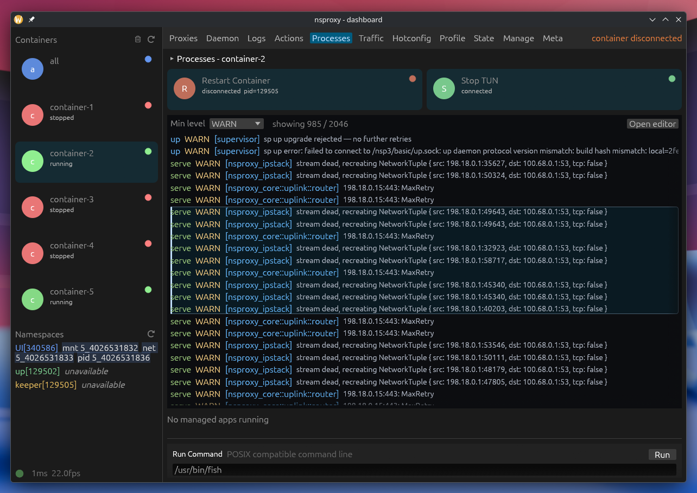

# egui_log_viewer

**A fast, virtualized log viewer for egui.** Show lots of logs without
rendering every row every frame.



## Why use it?

- **High frame rates with large logs.** Rows are virtualized: the row-rendering
  callback runs for visible rows, not the entire log collection. This has been
  proven in production use by [nsproxy](https://github.com/ple1n/nsproxy).
- **Select rows, not characters.** Drag or Shift-click to select a row range.
  Scrollbars and the mouse wheel still work during selection; dragging beyond
  the viewport edge scrolls while extending the selection.
- **Copy selection with Ctrl+C.** Supply the plain-text format for each row;
  the widget copies the selected range.
- **Put real egui UI in rows.** Render labels, buttons, progress bars, or any
  other egui widgets. Rows are not limited to rich text.
- **For logs, not code editing.** It has row-oriented selection, copy, and
  scrolling behavior. Use a text editor when you need character-level editing
  or selection.

There is no drop-in egui alternative that combines virtualized rows, row-range
selection and copying, and arbitrary egui widgets inside each row. Tables and
text editors serve different use cases.

## Add the crate

```toml
[dependencies]
egui = "0.36.2"
egui_log_viewer = "0.3.5"
```

## Quick start

`show_rows` accepts a slice, `Vec`, or `VecDeque`. Give each viewer a stable,
unique `id_source`, an estimated row height, a maximum height, a formatter for
copying, and a callback that draws each row.

```rust
use egui::{RichText, Ui};
use egui_log_viewer::LogViewer;

struct LogEntry {
    level: String,
    target: String,
    message: String,
    progress: f32,
}

fn show_logs(ui: &mut Ui, logs: &[LogEntry]) {
    let row_height = ui.text_style_height(&egui::TextStyle::Body);
    let output = LogViewer::show_rows(
        ui,
        "application-logs",
        logs,
        row_height,
        500.0,
        |row| format!("{} [{}] {}", row.level, row.target, row.message),
        |ui, index, row, selected| {
            ui.horizontal(|ui| {
                ui.label(format!("#{index}"));
                let level = RichText::new(&row.level).strong();
                ui.label(if selected {
                    level.color(ui.visuals().selection.stroke.color)
                } else {
                    level
                });
                ui.label(format!("[{}] {}", row.target, row.message));
                ui.add(egui::ProgressBar::new(row.progress).desired_width(100.0));
            });
        },
    );

    if let Some(range) = output.selected_rows {
        ui.label(format!(
            "Selected rows {}–{}",
            range.start() + 1,
            range.end() + 1
        ));
    }
}
```

The `add_row` callback receives the row index, row reference, and selection
state. It can build any egui UI. Label text selection is disabled inside the
callback by default, so dragging selects rows instead of text.

## What to know

- Rows are virtualized, but the data remains owned and filtered by your
  application.
- Variable-height rows are measured as they become visible. Pass a typical
  `row_height` so the viewer can estimate the initial layout.
- `selected_rows` is an inclusive range of row indexes.
- Copy output is defined by `row_to_text`; the widget cannot infer plain text
  from arbitrary egui widgets.
- Keep row callbacks inexpensive for the best frame rate.
- The viewer uses compact callback spacing by default: 8 points horizontally,
  3 vertically, and a 4-point gap between rows.

## Example

Run the interactive example from the repository root:

```sh
cargo run -p egui_log_viewer --example interactive
```

It compares structured, selectable log rows with a regular multiline text
editor.

## About

Vibe-coded by an experienced Rust developer. Licensed under MIT.

Feature requests are welcome; I’ll respond to them within 72 hours.
